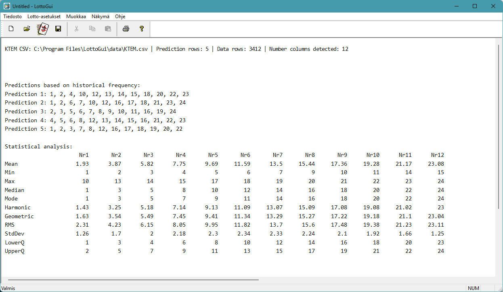

# LottoGui

LottoGui is a small Windows desktop application for generating lottery lines and viewing simple lottery analysis results.

The program is written in C++ with Microsoft Foundation Classes (MFC) and is intended to be opened and built in Microsoft Visual Studio on Windows. The project now supports both Win32 and x64 build targets.



## Features

- Generate classic lottery lines with a custom amount of numbers and rows
- Use either a numeric range or your own input number set
- Save and print generated results
- Check generated rows against user-entered main and bonus numbers and display a game-specific prize label such as `5 oikein!` or `Päävoitto!`
- Analyze Finnish Lotto CSV data from data/SuomenLottoData.csv
- Analyze Milli CSV data from data/MilliData.csv
- Analyze KTEM CSV data from data/KTEM.csv
- Analyze Keno CSV data from data/KenoData.csv
- Analyze Eurojackpot CSV data from data/EurojackpotData.csv
- Analyze Viking Lotto CSV data from data/VikingData.csv
- Analyze Jokeri CSV data from data/JokeriData.csv
- Create frequency-based prediction rows from historical data
- **Eight optional prediction strategies** for the CSV dialogs (Balanced, Delta, Wheel, Unusual, Consecutive, Magic Sum, Matrix, Portfolio Coverage)
- Display statistical analysis for Lotto, Milli, KTEM, Keno, Eurojackpot, Viking Lotto, and Jokeri number columns
- Custom application icon (`LottoGuiIcon.ico`) used by both the application and the installer
- Menu commands use distinct Microsoft Fluent System Icons from a language-neutral bitmap separate from the toolbar bitmap; their MIT license is included in the installer and in [LottoGui/res/icons/LICENSE.txt](LottoGui/res/icons/LICENSE.txt)

## Finnish Lotto CSV analysis

The application includes a separate Suomen Lotto dialog available from the Lotto Options menu. It reads the historical CSV file and shows:

- prediction rows based on historical frequency
- mean
- minimum and maximum
- median
- mode
- harmonic mean
- geometric mean
- root mean square
- standard deviation
- lower and upper quartiles

> Note: the predictions are statistical estimates based on past data and are not guarantees of future results.

Lottery draws are independent random events. Historical frequency and the optional
strategies alter how suggested lines are generated; they do not increase the
probability that any one valid line will win. Portfolio Coverage reduces overlap
between generated rows, which can broaden the set covered by a group of lines.

## Checking prediction rows

After generating rows, choose **Lotto Options → Check results...** and enter the
numbers to compare. Separate numbers with spaces, commas, or semicolons. For
games with bonus numbers, separate the main and bonus numbers with `|`, for
example `11 17 20 22 35 | 4 8`. The result view reports the match count for
each generated row and adds a game-specific prize label such as `5 oikein!`,
`6 oikein!`, or `Päävoitto!` when the selected game has a defined prize tier
for that result. For games with variable or unavailable prize tables, the
program shows a short textual summary instead of a fixed euro value, matching
the current rules for the selected game.

## Analytics report

Generated predictions and historical statistics are presented as a structured
report in the main window. The report uses a fixed A4-portrait page width and is
centered in the client area when there is enough room. It uses Segoe UI
throughout, with a clear report title, the selected game name, input and
ticket-cost details. Its sections always appear in this order: prediction
summary, statistical analysis, detailed strategy predictions, and conclusions.
The conclusion notes that historical draw results do not guarantee or predict
future outcomes. When results have been checked, each prediction card also
shows its matches and prize result. The report layout does not change prediction
or prize calculations. Printing uses the printer's printable page area, adds
page breaks automatically, and repeats section and table headings on
continuation pages. Print preview and paper output use the same measured report
layout.

## Ticket prices

Each CSV game's prediction dialog includes its current ticket-price options.
The selected options are remembered between runs. Prices are calculated in
cents and the generated results show the price per row and the total price for
all generated ticket rows, including additional strategy rows, wheel
combinations, and optional Jokeri repeat-profile rows.

| Game | Price per row |
|---|---:|
| Suomen Lotto | €1.00; optional Plus adds €0.50 |
| Milli | €1.00 |
| KTEM (All or Nothing) | €1.00–€5.00 in €0.50 steps; optional Onnenapila doubles the stake |
| Keno | €0.50–€10.00 in €0.50 steps; optional Kunkkukerroin doubles the stake |
| Eurojackpot | €2.00 |
| Viking Lotto | €1.00; optional Plus number adds €0.50 |
| Jokeri | €2.00; optional Double adds €1.00 |

Keno also lets you select a level from 2 to 10; the selected level is the
number of picks generated in each row. The fixed game prices and selectable
stake ranges are centralized in `LottoGui/LotteryPrices.h` for straightforward
updates when Veikkaus changes its prices.

## Milli CSV analysis

The application also includes a separate Milli CSV dialog in the Lotto Options menu. It reads historical Milli rows and shows:

- frequency-based prediction rows
- six main-number predictions (numbers 1–40)
- the same statistical analysis used for Suomen Lotto

> Note: Values outside the valid range 1–40 are automatically discarded during import.

## KTEM CSV analysis

The application also includes a separate KTEM CSV dialog in the Lotto Options menu. It reads historical Kaikki tai ei mitään rows and shows:

- frequency-based prediction rows
- twelve main-number predictions
- the same statistical analysis used for Suomen Lotto

## Keno CSV analysis

The application also includes a separate Keno CSV dialog in the Lotto Options menu. It reads historical Keno rows and shows:

- frequency-based prediction rows
- 2–10 predicted Keno numbers, according to the selected level
- statistical analysis for all 20 draw columns

## Eurojackpot CSV analysis

The application also includes a separate Eurojackpot CSV dialog in the Lotto Options menu. It reads historical Eurojackpot rows and shows:

- frequency-based prediction rows
- five main-number predictions
- two star-number predictions
- the same statistical analysis used for Suomen Lotto

## Viking Lotto CSV analysis

The application also includes a separate Viking Lotto CSV dialog in the Lotto Options menu. It reads historical Viking Lotto rows and shows:

- frequency-based prediction rows
- six main-number predictions
- a Viking number added randomly from 1 to 5 when generating the prediction
- the same statistical analysis used for the other lottery modes

## Jokeri CSV analysis

The application also includes a separate Jokeri CSV dialog in the Lotto Options menu. It reads historical Jokeri rows and shows:

- frequency-based prediction rows
- seven Jokeri digit predictions
- support for repeated digits in the same row
- optional predictions conditioned on the historical distribution of distinct-digit counts
- zero-aware statistical analysis
- harmonic mean displayed as N/A when a column contains zero values

## Optional prediction strategies

All CSV game dialogs (Suomen Lotto, Milli, KTEM, Keno, Eurojackpot, Viking Lotto) include eight optional strategies that can be enabled with check boxes. Frequency analysis is always used as the base; the selected strategies are layered on top.

| Strategy | Description |
|---|---|
| **Balanced** | Favors a near-even split of small/large and even/odd numbers; exact balance depends on the available numbers and row size. |
| **Delta technique** | Generates a sorted selection of distinct numbers within the minimum and maximum values in the historical data. |
| **Wheel system** | Enter at least n+1 numbers in the Numbers field; all combinations are shown when there are at most 100, otherwise 100 unique combinations are sampled at random. |
| **Unusual numbers** | Favours numbers above 31 with triple weight. |
| **Consecutive pair** | Includes at least one consecutive number pair when the available numbers allow it. |
| **Magic sum** | Samples rows whose total is within 80–120% of an expected sum estimated from historical number frequencies; if no sampled row meets the range, the closest sampled row is shown and marked. |
| **Matrix technique** | Builds a 3×3 matrix and uses its row, column, and diagonal sums as candidate numbers within the observed number range. |
| **Portfolio Coverage** | Generates a separate group of rows that favors numbers used less often in that group, while still using historical frequency weights and avoiding duplicate main-number combinations where possible. |

Each selected strategy generates its own additional group of rows; strategies do not override one another. The active strategies are listed at the bottom of the output, for example:

```
Active strategies: Balanced, Delta, Matrix, Coverage
```

Portfolio Coverage can reduce overlap between rows, but it does not change the
odds of an individual combination or guarantee a prize. The Wheel system also
only covers the combinations it prints, up to 100 rows.

## Data format

The CSV files should be placed in the `data` folder.

### Suomen Lotto example

The Suomen Lotto file contains semicolon-separated rows without a header line, for example:

```text
1;9;18;19;36;37;5
3;14;15;17;20;25;16
```

### Milli example

The Milli file contains semicolon-separated rows without a header line, for example:

```text
4;10;12;18;35;40
3;4;15;20;37;38
```

### KTEM example

The KTEM file contains a header line followed by semicolon-separated data rows in the format No1;No2;No3;No4;No5;No6;No7;No8;No9;No10;No11;No12.

### Keno example

The Keno file contains a header line followed by semicolon-separated data rows in the format No1;No2;...;No20.

### Eurojackpot example

The Eurojackpot file contains a header line followed by semicolon-separated data rows in the format Nr1;Nr2;Nr3;Nr4;Nr5;Star1;Star2.

### Viking Lotto example

The Viking Lotto file contains a header line followed by semicolon-separated data rows in the format Nr1;Nr2;Nr3;Nr4;Nr5;Nr6.

### Jokeri example

The Jokeri file contains a header line followed by semicolon-separated data rows in the format Nr1;Nr2;Nr3;Nr4;Nr5;Nr6;Nr7. Digits may repeat within the same row, and the value 0 is valid.

## Building the project

### Requirements

- Windows
- Microsoft Visual Studio with Desktop development with C++
- MFC support installed
- Win32 or x64 build tools available
- Inno Setup 6 for creating a Release x64 installer
- CMake 3.20 or later and a C++14 compiler for regression tests

### Build steps in Visual Studio

1. Open the solution file LottoGui.sln in Visual Studio.
2. Select either a Win32 or x64 configuration in Debug or Release mode.
3. Build the solution.
4. Run the application.

### Build from PowerShell

A helper script is included at [Build-LottoGui.ps1](Build-LottoGui.ps1). It builds the solution and, by default, also compiles the installer.

```powershell
# Builds the x64 Release version and creates the installer
.\Build-LottoGui.ps1

# Build Debug x64 without generating the installer
.\Build-LottoGui.ps1 -Configuration Debug -Platform x64 -SkipInstaller
```

The script locates the installed Visual Studio MSBuild tools automatically and then invokes Inno Setup (`ISCC.exe`) for the installer output in `installer\Output`.
Installer creation is supported only with `Release|x64`; use `-SkipInstaller` when building Debug or Win32.

### GoogleTest regression tests

The regression tests compile the same MFC-independent result parsing and matching
code used by the application. On the first configure, CMake downloads the pinned
GoogleTest release, so an internet connection is required.

```powershell
cmake -S tests -B tests/build
cmake --build tests/build --config Release
ctest --test-dir tests/build -C Release --output-on-failure
```

## Creating a Release installer

An Inno Setup installer script is included at [installer/LottoGuiSetup.iss](installer/LottoGuiSetup.iss).

1. Build the x64 Release version of the application.
2. Open [installer/LottoGuiSetup.iss](installer/LottoGuiSetup.iss) in Inno Setup Compiler.
3. Compile the script.
4. The installer output is created in [installer/Output](installer/Output).

The installer packages the application executable, the Visual C++ runtime
installer, and all CSV files from the [data](data) folder.

### Upgrade support

The installer supports in-place upgrades. Installing a new version over an existing one automatically removes the old version first. User data files in the `data` folder are never deleted during upgrade or uninstallation.

### Language selection

During installation the user can choose the UI language:

- **English** — English menu, dialogs, and help file (`LottoGui_en.chm`)
- **Suomeksi (Finnish)** — Finnish menu, dialogs, and help file (`LottoGui.chm`)

The selected language is stored in the registry (`HKLM\SOFTWARE\LottoGui\Language`) and applied automatically each time the application starts.

## Using the application

1. Start the program.
2. Open the Lotto Options menu.
3. Choose one of the available options:
   - Classic Lotto Options (Klassinen lotto)
   - Suomen Lotto CSV
   - Milli CSV
   - KTEM CSV
   - Keno CSV
   - Eurojackpot CSV
   - Viking Lotto CSV
   - Jokeri CSV
4. Generate results and review them in the client area.

## Localisation

The application supports English and Finnish UI languages. Menus, dialog
captions, controls, generated summaries, and result-check messages follow the
language selected by the installer. The language is stored in
`HKLM\SOFTWARE\LottoGui\Language` and can be changed by re-running the installer.

The resource file `LottoGui.rc` is saved as UTF-8 and declares
`#pragma code_page(65001)` so the Windows Resource Compiler reads Finnish
characters correctly.

## Help system

The application ships two compiled HTML Help files:

- `help/LottoGui.chm` — Finnish help
- `help/en/LottoGui_en.chm` — English help

Both are built from HTML sources, a table-of-contents file (`.hhc`), a keyword-index file (`.hhk`), and a project file (`.hhp`) using **HTML Help Workshop** (`hhc.exe`).

### Encoding requirement for HHC and HHK files

`hhc.exe` reads `.hhc` and `.hhk` files as **ANSI (Windows-1252)**, regardless of any charset declaration. The HTML topic files themselves can be UTF-8 (they carry their own `<meta charset>` tag), but the TOC and index files must be saved as Windows-1252, otherwise Scandinavian characters (ä, ö) and special punctuation (–) appear garbled in the compiled CHM's Contents and Index panes.

When editing `.hhc` or `.hhk` files in VS Code, re-save them with the correct encoding:
`Ctrl+Shift+P` → *Change File Encoding* → *Save with Encoding* → **Western (Windows 1252)**.

### Rebuilding the CHM files

```
"C:\Program Files (x86)\HTML Help Workshop\hhc.exe" help\LottoGui.hhp
"C:\Program Files (x86)\HTML Help Workshop\hhc.exe" help\en\LottoGui_en.hhp
```

## Project status

This is a lightweight hobby-style MFC application focused on lottery line generation and simple statistical exploration.
